<p align="center">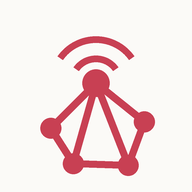</p>

# MeshCore Companion

A self-hosted web app for your [MeshCore](https://meshcore.io) LoRa radio. A small always-on computer (a Raspberry Pi works well) holds the Bluetooth link to your companion radio. Any phone, tablet or laptop on your network then gets the full chat experience in the browser, plus signal and debug stats the official app doesn't show. You can install it to your home screen as a PWA, with push notifications.

> Unofficial and community-made: not affiliated with the MeshCore project.

<p align="center">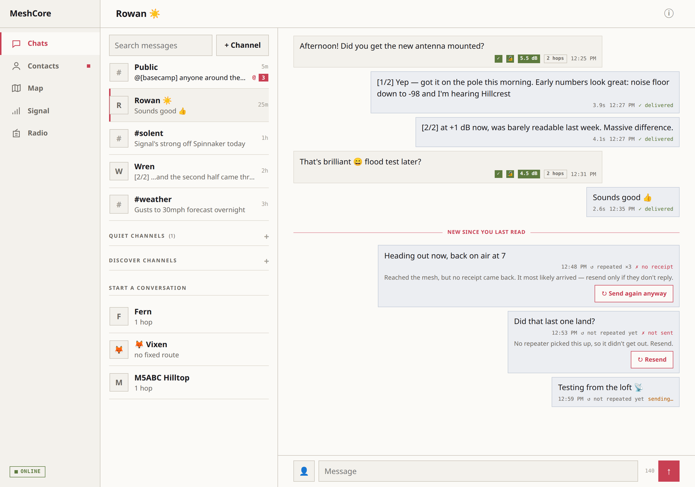</p>

## Screenshots

> Synthetic demo data — not real contacts, keys or locations.

<table>
<tr>
<td align="center" width="33%">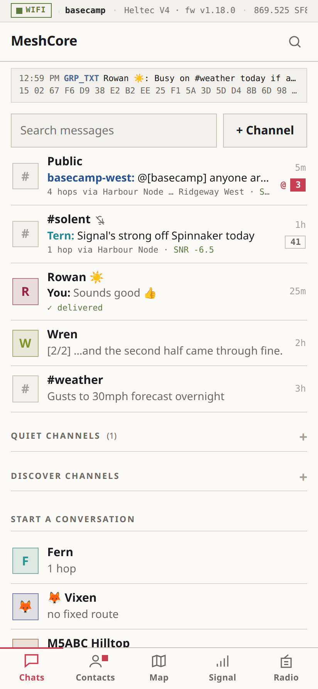<br><sub><b>Chats</b> — DMs &amp; channels, unread and mentions</sub></td>
<td align="center" width="33%">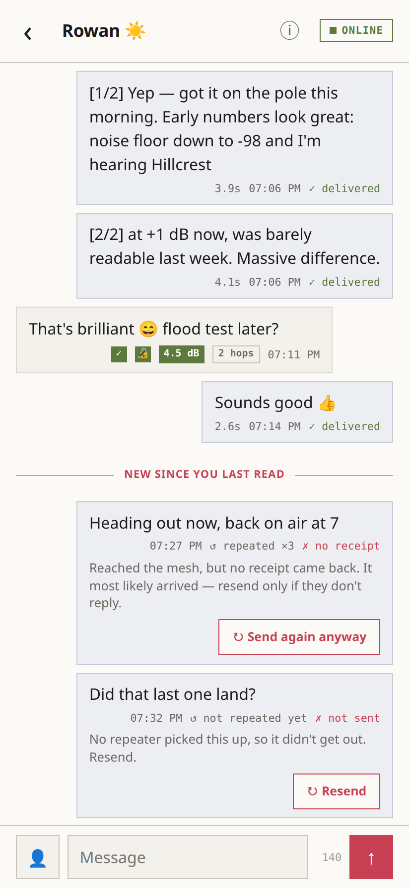<br><sub><b>Conversation</b> — auto-split parts, delivery ticks, SNR and signed badges</sub></td>
<td align="center" width="33%">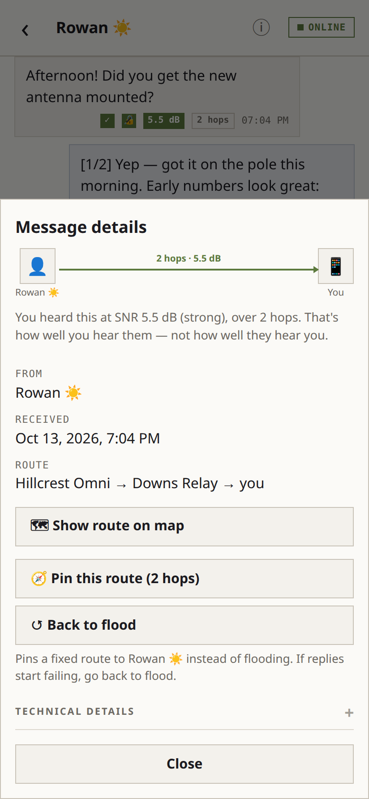<br><sub><b>Message details</b> — journey diagram: repeats, receipt, route</sub></td>
</tr>
<tr>
<td align="center">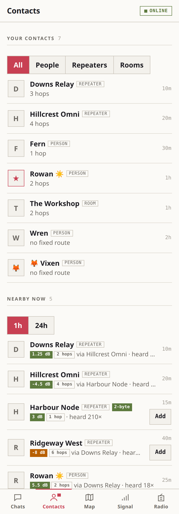<br><sub><b>Contacts</b> — favourites, nearby now, 1/2-byte path badges</sub></td>
<td align="center">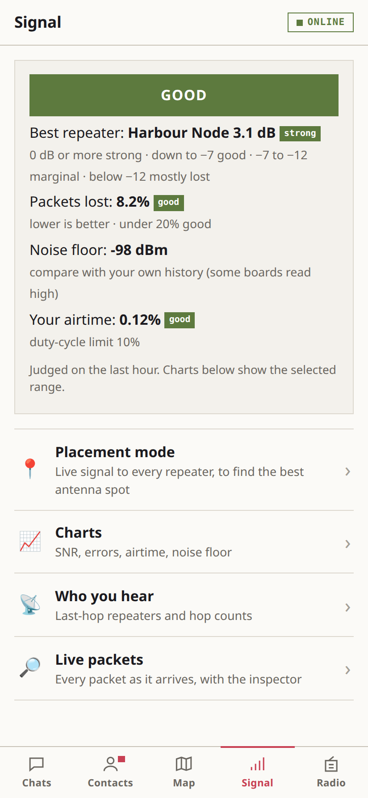<br><sub><b>Signal</b> — link health card, then charts, who you hear and live packets</sub></td>
<td align="center">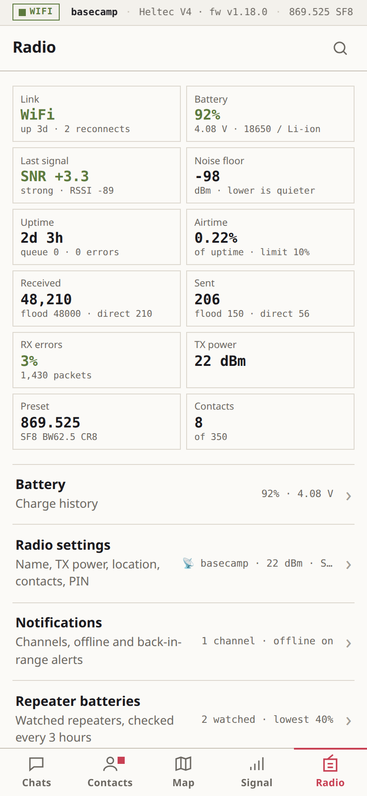<br><sub><b>Radio</b> — status tiles, then settings, notifications, filters and more</sub></td>
</tr>
<tr>
<td align="center">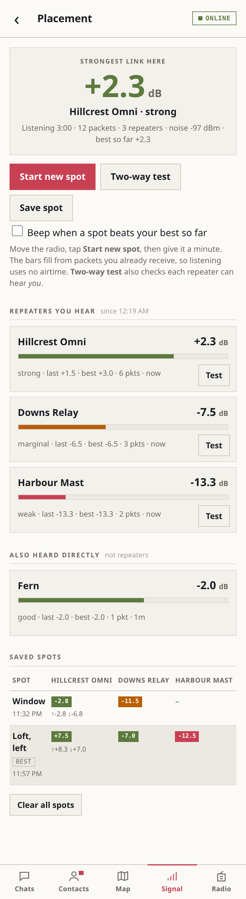<br><sub><b>Placement mode</b> — live signal to every repeater, save and compare spots</sub></td>
<td align="center">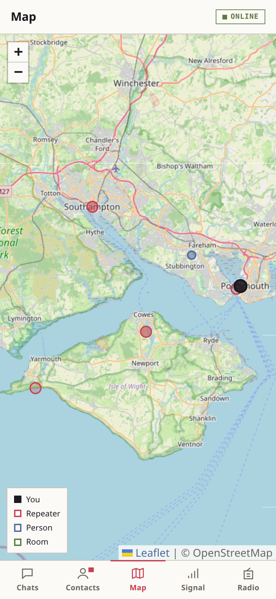<br><sub><b>Map</b> — every located node you've heard, plus your radio</sub></td>
<td></td>
</tr>
</table>

## Features

**New: 👍 Reactions and swipe to reply** — hold a message (or right-click it) to react with 👍 ❤️ 😂 😮 😢 🙏, reply, copy or open its details; swipe a message right to reply. MeshCore has no reaction packet, so a reaction goes out as an ordinary short message any client can read (`@[Alice] 👍` in a channel, `👍` in a DM, with a short `"quote…"` added when it's for an older message) and this app folds it under the message it's for. Replying in a channel starts your post with `@[Name] ` so they get a mention; the "replying to" quote stays on your screen and costs no bytes.

**New: ✨ Screens that slide** — on phones, opening a chat or a settings page slides it in over the last one and Back slides it away, like a native app (Safari 18+, Chrome 111+); tabs swap with a short slide while the highlight glides across. Recently opened chats appear instantly, and messages start loading as soon as your finger touches a chat. Sheets and toasts animate out too. All of it is off with the system's reduce-motion setting.

**New: 🎨 Colour themes and contact colours** — Radio → Appearance: Kanagawa, Nord, Gruvbox, Solarized or High contrast, each in light and dark. Every contact gets its own colour from their name, so busy channels are easy to follow. The chat list shows who spoke last (**You:** or the channel sender), Contacts has search and a ★ favourites filter, and the whole app has quick, small animations (off with the system's reduce-motion setting).

**New: ⚙️ Every radio setting** — Radio → Settings now covers everything the companion firmware exposes: name and BLE PIN; location, whether adverts share it, and **GPS on/off** (shown when the radio detects a GPS module at power-on); TX power and the LoRa preset (frequency, bandwidth, SF, CR — locked behind a checkbox, with the UK/EU Narrow preset); who may read your battery, location and sensor telemetry; contact handling; 1- or 2-byte path hashes, the on-screen clock's timezone, airtime factor, RX delay and extra delivery receipts. Only changed values are written, and LoRa values are validated as a set.

**New: 🔎 Packet inspector** — Signal → Live packets: tap any packet to see its raw bytes as a colour-coded hex dump, with every field named and explained (header, route, each hop by repeater name, advert key/location/name, ACKs, trace SNRs). Channel traffic is **decrypted** with every key the app knows (your channels, Public, discovered `#hashtags`), and signature packets are split into key id, signed time and signature. Filter by type, pause the log, copy the hex, or **Show route on map**. Raw packets are kept for 7 days.

**📶 WiFi radio link** — companion firmware v1.18's normal BLE build also speaks WiFi. Set `RADIO_HOST` and the bridge connects over your network instead of Bluetooth (no more BLE drop-outs), while your phone can still use Bluetooth. Set the radio's WiFi from the bridge with `POST /api/radio/cli` (`set wifi.ssid …`, `set wifi.pwd …`, `reboot`), which runs any companion CLI command on your own radio.

**🟢 Last heard** — a dot on every person in Chats and Contacts, and "heard 5m ago" in the DM header: green under 15 minutes, amber under 2 hours. MeshCore has no presence, so it's the last sign of life the bridge saw (an advert, a DM, a channel post, a delivery receipt or a repeater relaying) — their radio, not whether they're reading.

**likely route on saved-route DMs** — a DM sent down a saved route arrives with no hop list (each repeater removes itself as it forwards). The chip, journey diagram and details now show your saved route to them, reversed, as the likely path, with each 1-byte hop matched to the nearest repeater along the chain.

**🔎 Packet inspector** — Signal → Live packets: tap any packet to see its raw bytes as a colour-coded hex dump, with every field named and explained (header, route, each hop by repeater name, advert key/location/name, ACKs, trace SNRs). Channel traffic is **decrypted** with every key the app knows (your channels, Public, discovered `#hashtags`), and signature packets are split into key id, signed time and signature. Filter by type, pause the log, copy the hex, or **Show route on map**. Raw packets are kept for 7 days.

**🗺️ Live packet trails and mesh links** — on the Map, each packet you receive is replayed as a dot travelling sender → repeaters → you. Tick **Links heard (24 h)** to draw the repeater-to-repeater network built from every path you've heard: thicker lines carry more traffic, and your own links are coloured by SNR. Hop IDs are 1–2 byte key prefixes, so each is matched to the located node nearest the next hop (repeaters preferred).

**✍️ Signed filter** — Live packets can show only signed traffic: signature packets and every heard copy of the post they sign, marked with who signed.

**menus for Signal and Radio** — both open on a short menu (Charts, Who you hear, Live packets… / Settings, Notifications, Spam filters…), each feature on its own page.

**🖥️ Desktop layout** — on a laptop or desktop browser (1024 px and wider) the app gets a sidebar instead of bottom tabs, Chats and Contacts open beside their list instead of on a new page, and charts sit in two columns. `Esc` closes the open chat, `/` jumps to search. Phones and tablets are unchanged.

**📍 Placement mode** — find the best spot for your antenna. Signal → Placement mode shows a live bar for every repeater you hear directly, built from packets you already receive (no extra airtime). Move the radio, tap **Start new spot**, give it a minute; **Two-way test** checks each repeater hears *you* too. Save each spot and the app compares them in a table and marks the best, with an optional beep when a spot beats your best so far.

**Chat**
- DMs and channels (Public, `#hashtag` and private), with live updates.
- Delivery ticks, automatic retries, and a Resend button. Every sent message says plainly whether to resend: "no receipt" (reached the mesh, most likely arrived) vs "not sent".
- **Journey diagram** on every message: you → repeaters → them, each leg coloured by what's actually known (repeats heard, receipt back, SNR).
- **"New since you last read"** divider, and the conversation opens right there.
- **Repeat counter** on channel posts: "↺ 2 repeats via X, Y" proves your message actually went out.
- DM diagnostics: for a failed DM, it tells you whether it reached the mesh (no receipt came back) or never got repeated.
- Colour-coded **SNR** and **hop count** on every received message. Tap a message for its route, RSSI, round-trip time and sender clock.
- `@mentions` (tap a name to reply), unread counts, and a badge on the home-screen icon.
- **Room servers:** posts relayed by a room show their original author.
- **Contact cards:** `<pubkey:type:name>` cards pasted in chat become a one-tap **Add** button, and the 👤 button posts your own card.
- Full-text search across your history, and an offline banner.
- **Push notifications** for DMs, mentions and channels you choose (Web Push, including iOS 16.4+ when installed to the home screen).
- Duplicate copies of the same message (sender retries or multi-path) are collapsed.

**Contacts and channels**
- Add contacts from `meshcore://` links or from heard adverts. Share your own contact, remove contacts.
- **Nearby now:** nodes heard advertising in the last hour or day, with signal and hop count.
- **Channel discovery:** finds active `#hashtag` channels by verifying candidate names against packets heard on air. Includes a "try a name" box.
- Add and remove channels (paste a `meshcore://channel/add` link straight in). Private channels show their key so you can share it.
- **Callsign profiles:** UK amateur callsigns in node names (`M0ABC Repeater`, `Phil(M1ABC)`) get a 📻 chip. Tap it for licence class, region and **"Ham since"** (from when that callsign series was issued, e.g. M5 → 1999–2001), plus a link to their QRZ.com page. Add a QRZ login to the bridge to see names and towns too.
- **QR codes:** show yours (or any contact's) for someone to scan, and scan theirs with the camera. Contact and channel links both work.
- **Self-managing contacts:** people and rooms you hear are added automatically. Only when the radio's contact table is nearly full do the least recently heard contacts rotate out to make room; nothing is removed just for being a repeater. ★ **Favourites** are never removed.
- **Route control** per contact: pin a fixed route through a heard repeater, or go back to flood. DMs that arrived on a saved route say so.
- **1-byte / 2-byte path-hash badge** on every node, from its adverts — spot who's on 2-byte MeshCore.

**Repeater and room admin**
- Log in (admin or guest), see status and telemetry (battery as %), and run CLI commands from a console. Over-the-air requests retry automatically on marginal links.
- **Trace** gives the SNR in both directions to a neighbouring repeater. **Find path** names the repeaters between you and a contact.
- **Status in plain words:** battery %, packets waiting, packets dropped while busy, duplicates and airtime — the numbers that explain lost messages.
- **Repeater battery watch:** checks a repeater's battery every 3 hours (logging in with the guest password if needed) and notifies you when it drops below your threshold.
- **Back in range alerts:** a push when a ★ favourite you haven't heard from in 6+ hours shows up again.

**Signal and debug**
- **Link health card:** judged on the last hour, with every number graded 🟢 good / 🟠 ok / 🔴 bad in plain words: best repeater, packets lost to errors, airtime, noise floor, and an overall verdict.
- Charts: best-repeater SNR trend, error % per hour, packet SNR/RSSI scatter, noise floor, battery.
- **Airtime vs the 10% duty-cycle limit** (EU/UK 869.4–869.65 MHz), plus how busy the mesh is.
- A "who you hear" table (last-hop repeaters), a hop histogram and a live packet log with type and ✍️ Signed filters.
- **Packet inspector:** hex dump + decoded fields for any packet, channel payloads decrypted.
- Per-contact DM delivery stats: delivered, failed, and average round-trip time.
- Prometheus metrics at `/api/metrics`.

**Radio**
- Name, TX power, location, manual-add mode and a **fixed Bluetooth PIN**. Zero-hop and flood adverts, reboot.
- Radio clock synced on every connect.

**App**
- Installable PWA, phone-first, sharp minimal design. **Five colour themes, light, dark or follow the system.**
- In-app confirmations and toasts (no browser pop-ups, which iOS home-screen apps can block).
- Keeps your place when you switch apps; live updates never jump the scroll.

## How it works

A small always-on computer sits next to your radio and holds the link to it, by **USB cable or Bluetooth**. Everything else (your phone, tablet, laptop) talks to that computer through a web page.

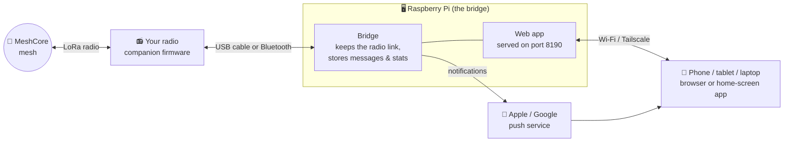

- **The radio** stays on the mesh 24/7, even when your phone is off or away.
- **The bridge** is the only thing that talks to the radio. It keeps every message, so you can catch up from any device, and it sends push notifications.
- **The web app** works in any browser. Install it to your home screen and it behaves like a normal app.

<details><summary>What happens when you send a message</summary>

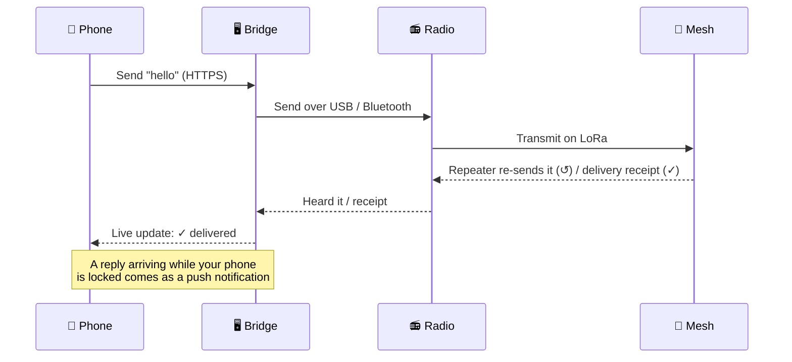
</details>

## Setup guide

**Most people: about 20 minutes, with one install command.** You need four things:

| | What | Notes |
|---|---|---|
| 📻 | **A MeshCore companion radio** | Heltec V3/V4, RAK4631, T-Echo, XIAO… running **Companion** firmware: the **USB** or **BLE** version (step 1). |
| 🖥️ | **A Raspberry Pi** (or any Linux box) | Pi Zero 2 W, Pi 4 or Pi 5. It stays on, **plugged into the radio by USB** (it powers the radio too) or within Bluetooth range (a few metres). |
| 📱 | **A phone** | iPhone (iOS 16.4+) or Android. |
| 🌐 | **Wi-Fi** | The Pi and your phone on the same network. Or use Tailscale for anywhere. |

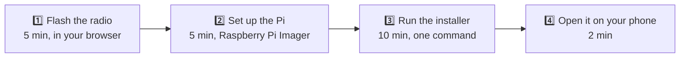

### 1️⃣ Flash the radio

First decide how the Pi will talk to the radio:

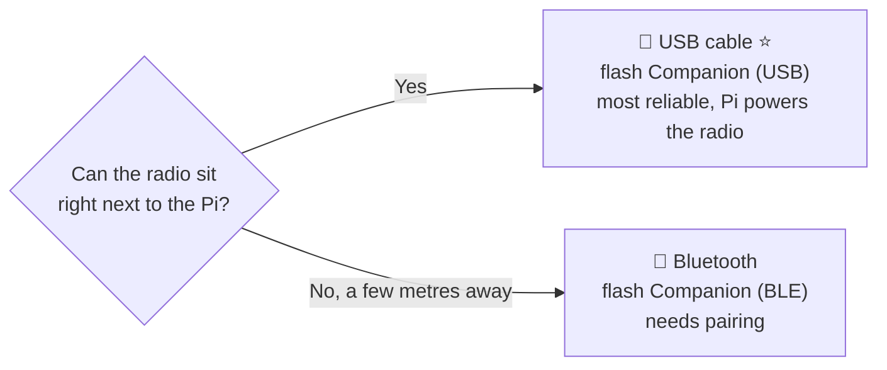

1. Plug the radio into your computer with a USB cable.
2. Open **[flasher.meshcore.io](https://flasher.meshcore.io)** in Chrome or Edge.
3. Pick your board, then **Companion (USB)** or **Companion (BLE)**, and press flash.

> 💡 **USB:** the radio is then only reachable through the Pi, not from the MeshCore phone app. That's fine, because this app replaces it.
>
> 💡 **Bluetooth:** a companion radio talks to **one** Bluetooth device at a time. If you've used it with the MeshCore phone app, disconnect it there and "Forget" it in your phone's Bluetooth settings, or the phone and the Pi will fight over it.

### 2️⃣ Set up the Pi

1. Install **[Raspberry Pi Imager](https://www.raspberrypi.com/software/)** on your computer and insert the Pi's SD card.
2. Choose **Raspberry Pi OS Lite**: the 64-bit version, or 32-bit for an original Pi Zero W.
3. Click **Edit settings** and fill in a hostname (e.g. `meshpi`), a username and password, your **Wi-Fi**, and turn on **SSH**.
4. Write the card, put it in the Pi, power it on and wait about two minutes.
5. Connect from your computer: `ssh yourname@meshpi.local`

### 3️⃣ Run the installer

On the Pi:

```sh
sudo apt install -y git
git clone https://github.com/edleeman17/meshcore-companion.git
cd meshcore-companion && ./install.sh
```

The installer walks you through everything and asks before changing anything:

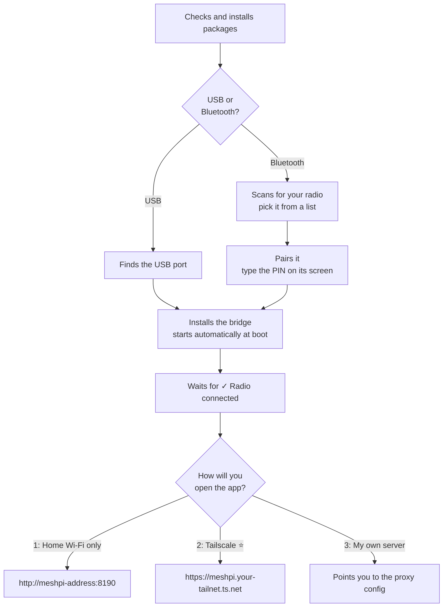

At the end it prints the web address to open (and a QR code if `qrencode` is installed).

### 4️⃣ Open it on your phone

1. Open the address from step 3 in **Safari** (iPhone) or **Chrome** (Android).
2. Tap **Share → Add to Home Screen**.
3. Open **MeshCore** from the new icon. On iPhone, notifications only work when it's opened from the icon.
4. Go to **Radio → Notifications → Enable notifications** → Allow, then **Send a test**.

**Check it works:**
- [ ] The badge at the top says **Online**.
- [ ] **Chats** shows Public; **Contacts → Nearby** fills up within a few minutes.
- [ ] A message on Public shows **✓ on mesh · ↺×1** (or more) once a repeater re-sends it.
- [ ] **Bluetooth only:** under **Radio → Radio settings → Fixed Bluetooth PIN**, set one and reboot the radio. Then run `./install.sh` again and pair with the new PIN, so pairing survives reboots.

### Choosing how to open the app (HTTP, Tailscale or your own HTTPS)

Browsers only allow **notifications** and **install as an app** on a secure (HTTPS) address. Pick what suits you; you can change later by re-running `./install.sh`.

| | 1: Home Wi-Fi only | 2: Tailscale ⭐ recommended | 3: Your own HTTPS |
|---|---|---|---|
| **Effort** | none | ~5 min, free account | depends on your setup |
| **Chat, contacts, signal stats** | ✅ | ✅ | ✅ |
| **Push notifications** | ❌ | ✅ | ✅ |
| **Works away from home** | ❌ | ✅ (private, nothing exposed to the internet) | if you expose it |
| **Install to home screen as an app** | ⚠️ bookmark only | ✅ | ✅ |

<details><summary><b>Option 2: Tailscale</b>, step by step</summary>

[Tailscale](https://tailscale.com) is a free private network between your own devices, and it gives the Pi a real HTTPS certificate. The installer does this for you; by hand it's:

1. On the Pi: `curl -fsSL https://tailscale.com/install.sh | sh` then `sudo tailscale up` and open the login link it prints.
2. In the [Tailscale admin console](https://login.tailscale.com/admin/dns), turn on **MagicDNS** and **HTTPS Certificates**.
3. On the Pi: `sudo tailscale serve --bg 8190`
4. Install the **Tailscale app** on your phone and sign in with the same account.
5. Open `https://<pi-name>.<your-tailnet>.ts.net`. `tailscale serve status` shows the exact address.
</details>

<details><summary><b>Option 3: your own HTTPS</b> (Caddy, nginx, Docker, Nomad…)</summary>

The bridge serves the whole app on port `8190`, so any reverse proxy just forwards everything there. Keep response buffering **off** for `/api/stream` (live updates).

- **Caddy with a real domain** (automatic Let's Encrypt): `mesh.example.com { reverse_proxy meshpi.local:8190 }`
- **Caddy on a home network** (no domain): `mesh.lan { tls internal; reverse_proxy meshpi.local:8190 }`, then trust Caddy's root certificate on your phone (see below).
- **nginx:** see `pwa/nginx.conf.template` (it serves the static files itself and proxies `/api/`).
- **Docker** (front end only): set `BRIDGE_URL` in `docker-compose.yml`, then `docker compose up -d --build`, and put it behind your HTTPS proxy.
- **Nomad:** `examples/nomad-pwa.nomad.hcl`.

**Trusting a home-made certificate on your phone** (mkcert or Caddy `tls internal`): send yourself the root certificate (`mkcert -CAROOT` → `rootCA.pem`).
- **iPhone:** install it in **Settings → General → VPN & Device Management**, then enable it in **Settings → General → About → Certificate Trust Settings**.
- **Android:** **Settings → Security → Encryption & credentials → Install a certificate → CA certificate**.
</details>

### Updating

On the Pi:
```sh
cd meshcore-companion && git pull && ./install.sh
```
It keeps your radio, pairing and settings. The radio link drops for about 30 seconds while the bridge restarts. Then close and reopen the app on your phone.

<details><summary>Advanced: install from another computer instead (<code>deploy.sh</code>)</summary>

If you keep the repo on a workstation and push to the Pi over SSH (handy when developing):

```sh
cp examples/deploy.env.example deploy.env
nano deploy.env            # HOST = ssh name of the Pi; RADIO_HOST (WiFi), RADIO_SERIAL (USB port) or RADIO_ADDRESS (Bluetooth)
./bridge/deploy.sh         # installs/updates the bridge and the web app it serves
```
For Bluetooth, pair first on the Pi with `./bridge/pair.sh AA:BB:CC:DD:EE:FF 123456`. For USB, add yourself to the `dialout` group on the Pi. If you host the front end elsewhere, `PWA_DEST=server:/path ./pwa/deploy.sh` copies the static files there.
</details>

### Optional extras

Settings live in `~/.config/meshcore-bridge.env` on the Pi. After editing, restart with `systemctl --user restart meshcore-bridge`. All options are under [Configuration](#configuration).

- **Callsign profiles:** add `QRZ_USERNAME` / `QRZ_PASSWORD` to show names and towns for callsigns in node names.
- **Channel discovery:** `DISCOVER_NAMES="mytown mycounty"` tests your local `#hashtag` names against what's heard on air.
- **Backups:** `BACKUP_DIR` sets where the nightly database copy goes (default `~/meshcore-backups`, 14 days kept).
- **In the app:** ★ favourite your local repeaters, turn on **Battery watch** for the ones you rely on, and try **Signal → Placement mode** to find the best spot for your antenna.

## Reading the numbers

| Metric | Meaning | Good |
|---|---|---|
| **SNR** (dB) | How far a signal stands above the noise. This decides whether a packet decodes. At SF8 the limit is about −12.5 dB. | 🟢 > −5 · 🟠 −5…−12.5 · 🔴 below |
| **RSSI** (dBm) | Raw signal strength. Closer to 0 is louder. | Context only |
| **Noise floor** (dBm) | Background hiss. Boards with a front-end LNA (e.g. Heltec V4) read higher, so compare against yourself over time. | Lower is better |
| **Packets lost** (%) | Packets heard but failed CRC. | 🟢 < 20% · 🟠 < 40% · 🔴 above |
| **Airtime** (%) | Your transmit time per hour. The EU/UK 869.4–869.65 MHz sub-band allows 10%. | ≪ 10% |
| **Hops** | Repeaters a packet passed through ("direct" = none). | — |

"↺ 0 repeats" is inconclusive: it means *you* didn't hear an echo, not that nobody received the message.

## Configuration

Bridge environment (`~/.config/meshcore-bridge.env`, see `bridge/meshcore-bridge.env.example`):

| Variable | Purpose |
|---|---|
| `RADIO_HOST` | **WiFi:** the radio's IP (optionally `ip:port`, default port 5000). Needs companion firmware **v1.18+**: flash the normal BLE build, then set the network with `POST /api/radio/cli` (`set wifi.ssid …`, `set wifi.pwd …`, `reboot`). BLE keeps working alongside. Takes priority over the others. Port 5000 has no authentication, so give the radio a fixed IP and keep it on a trusted network. |
| `RADIO_SERIAL` | **USB:** the radio's serial port, e.g. `/dev/serial/by-id/usb-…` or `/dev/ttyACM0` (USB companion firmware). Takes priority over `RADIO_ADDRESS`. Your user needs to be in the `dialout` group. |
| `RADIO_BAUD` | USB speed. Default `115200`. |
| `RADIO_ADDRESS` | **Bluetooth:** BLE MAC of the radio (BLE companion firmware). Set this or `RADIO_SERIAL`. |
| `RADIO_PIN` | Only if you want the bridge to pair itself. Leave unset after `pair.sh`. |
| `VAPID_PRIVATE_KEY` / `VAPID_PUBLIC_KEY` / `VAPID_SUBJECT` | Web Push. |
| `DATA_DIR` | SQLite location. Default `~/.local/share/meshcore-bridge`. Use local disk, not a network share. |
| `DISCOVER_NAMES` | Extra `#hashtag` names (your towns and topics) to test for channel discovery. |
| `BACKUP_DIR` | Nightly backup destination. Default `~/meshcore-backups`, 14 days kept. |
| `QRZ_USERNAME` / `QRZ_PASSWORD` | Optional QRZ.com login for callsign profiles. A free account gives name, town and country; a QRZ XML subscription adds photo and grid. Lookups are cached for 30 days. |

## Troubleshooting

| Symptom | Fix |
|---|---|
| USB: "not found: is the radio plugged in by USB?" | Use a **data** USB cable (many are charge-only), check `ls /dev/serial/by-id/`, and that `RADIO_SERIAL` matches. |
| USB: "no answer over USB" | The radio is running the BLE firmware. Re-flash it with **Companion (USB)**. |
| "Radio offline", log shows `Failed to connect` / drops seconds after connecting | Another device (often the phone app) is grabbing the radio. Disconnect or forget it there. |
| Worked until the radio rebooted, now `AuthenticationFailed` or constant drops | The radio's PIN changed (random PIN mode). Set a **fixed PIN**, reboot the radio, then re-run `pair.sh`. |
| Connected, but contacts and channels are empty | Restart the radio. The bridge retries loading by itself and keeps cached channel names meanwhile. |
| DMs fail with "reached the mesh, no receipt" | The recipient doesn't have your contact (send a **flood advert**), or their radio is off or out of range. |
| No notifications on iPhone | Must be installed to the home screen and opened from there, on iOS 16.4+, over trusted HTTPS. |
| Composer hidden after closing the iPad keyboard | Fully close and reopen the app to load the latest version. |
| Banner says "Radio not responding… unplug it" | The radio's Bluetooth has hung (seen every few hours on some boards). Power-cycle it; the bridge reconnects by itself. |
| Great receive numbers but your posts get 0 repeats / traces fail | Antenna detuned by nearby metal (window handles, frames) or blocked by low-E glazing. Move it away from metal or outside. |

Logs are in `~/.local/share/meshcore-bridge/bridge.log` on the bridge host.

## API

Everything the UI does is available over HTTP:
- `GET /api/state`, `/api/contacts`, `/api/conversations`, `/api/messages/{dm|chan}/{peer}`, `/api/search?q=`, `/api/stats?range=24h`, `/api/nearby`, `/api/delivery`, `/api/channels/discovered`, `/api/placement?mins=10`, `/api/battery-watch`, `/api/callsign/{call}`
- `GET /api/stream`: Server-Sent Events (`message`, `message_update`, `packet`, `sample`, `status`, …)
- `POST /api/send {kind, to, text}`, `/api/advert?flood=true`, `/api/contacts/import {uri}`, `/api/contacts/{key}/trace|discover|login|cli`, `/api/trace/{hop}`, `/api/battery-watch/{key}`, `/api/channels {name}`, `/api/settings {…}`
- `GET /api/metrics`: Prometheus metrics. `GET /health`: 503 once the radio has been down for more than 2 minutes, which suits uptime monitors.

## Privacy

Everything stays on your own machines. The bridge stores messages, packet metadata and stats in a local SQLite file. There's no telemetry and no third-party service, apart from map tiles (OpenStreetMap) and your browser's own push service. Channel discovery only ever identifies `#hashtag` channels, whose names *are* their keys. Private channels can't be guessed.

## Credits

- [MeshCore](https://meshcore.io) ([source](https://github.com/meshcore-dev/MeshCore)) and [meshcore_py](https://github.com/meshcore-dev/meshcore_py), which do the hard work.
- [uPlot](https://github.com/leeoniya/uPlot) (MIT) and [Leaflet](https://leafletjs.com) (BSD-2), bundled in `pwa/static/vendor/`.

## License

MIT, see [LICENSE](LICENSE).
